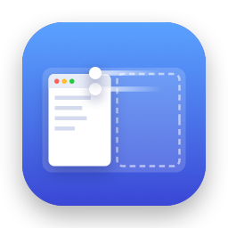
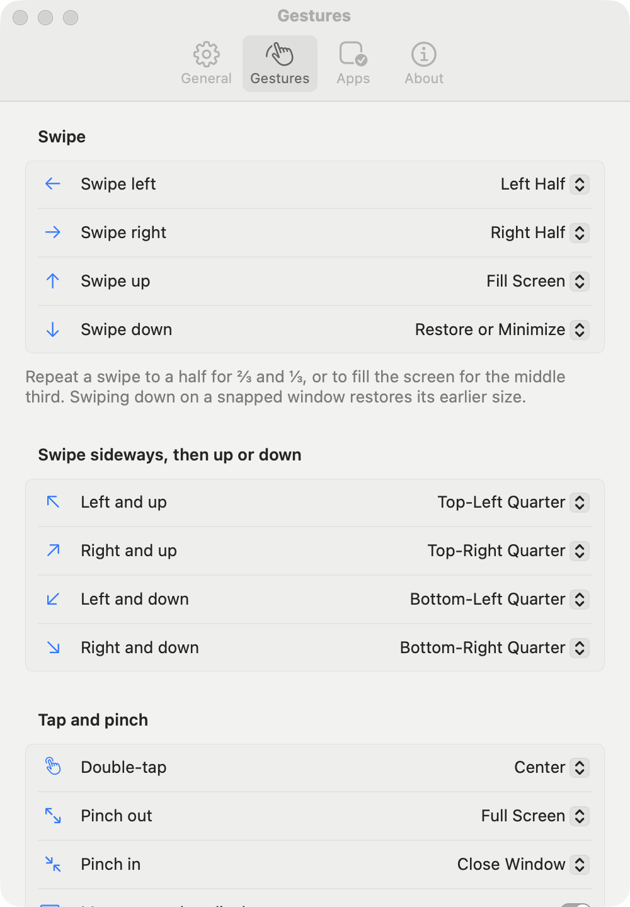
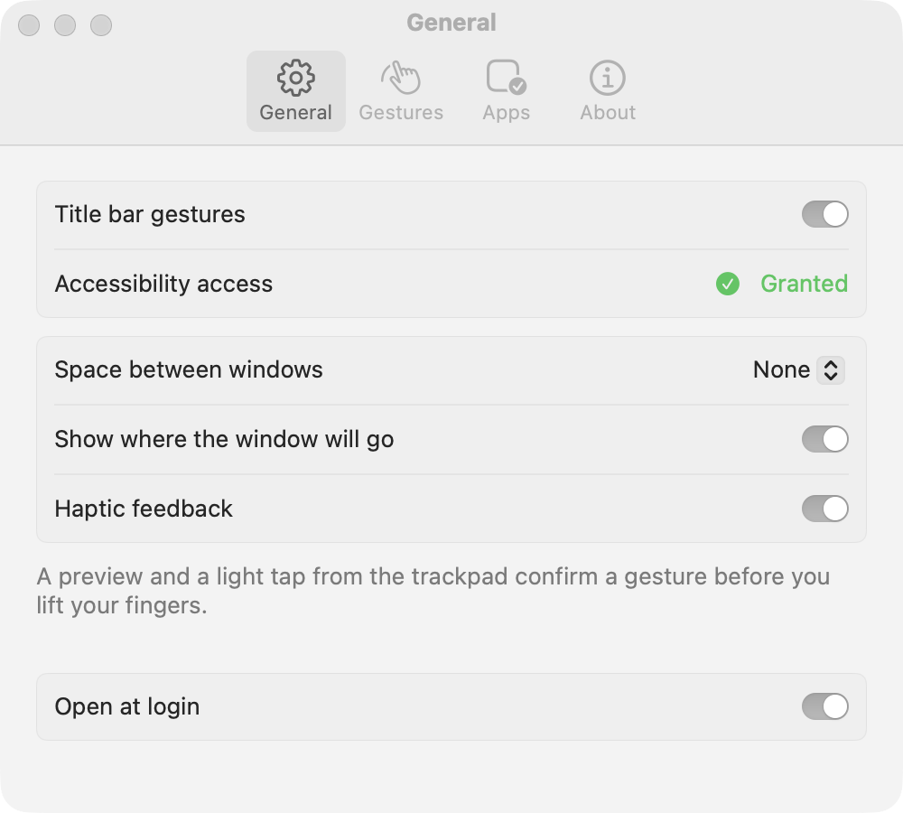
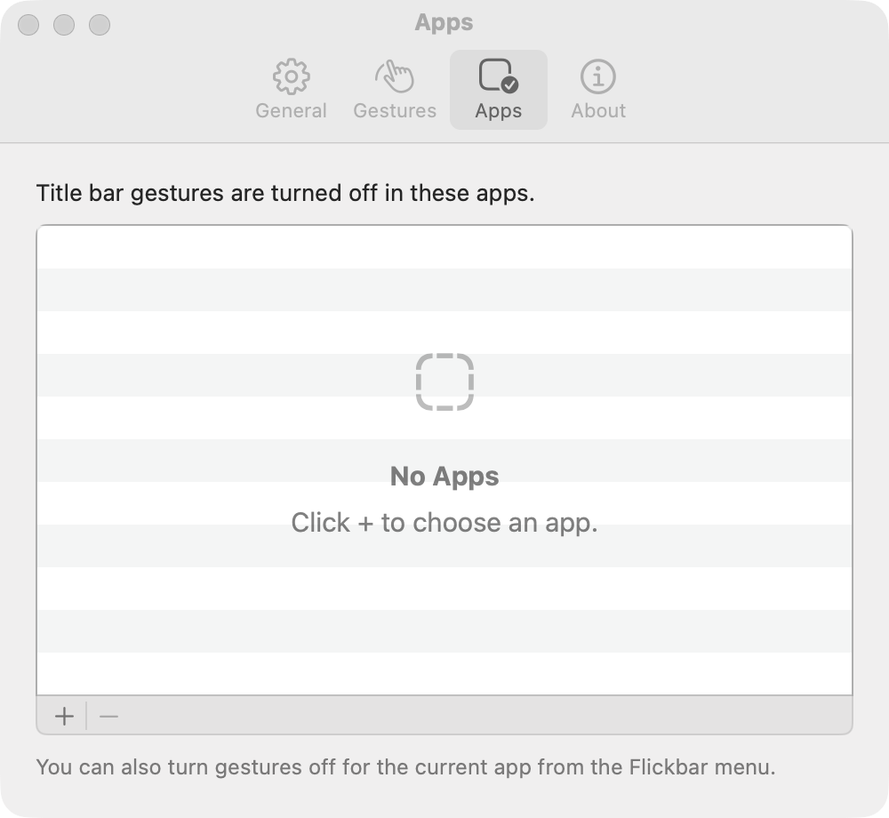
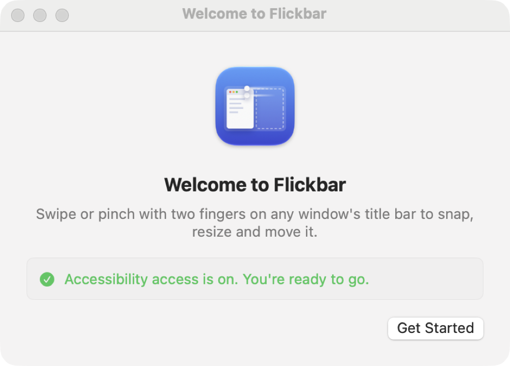

<p align="center">
  
</p>

<h1 align="center">Flickbar</h1>

<p align="center">
  Snap, resize and move macOS windows with trackpad gestures on their title bars.<br>
  Free and open source. <a href="https://flickbar.github.io/">Website</a>. Made by <a href="https://github.com/benymaxparsa">Parsa Kamalipour</a>.
</p>

<p align="center">
  
</p>

## Gestures

Put the pointer on a window's title bar and use two fingers:

| Gesture | Result |
|---|---|
| Swipe left / right | Snap to the left / right half; repeat for ⅔, then ⅓ |
| Swipe left or right, then up or down (either order) | Snap to that quarter |
| Swipe up | Fill the screen; repeat for the middle third |
| Swipe down | Minimize |
| Double-tap | Center the window |
| Pinch out | Toggle full screen |
| Pinch in | Close the window |
| Hold ⌘ and swipe | Move the window to the display on that side |
| Touch, hold, then move | Pick a layout from a grid (see below) |

Hold ⌥ Option to use the same gestures anywhere in a window, not just on its title bar.

**Grid.** Rest two fingers on a title bar for a moment before swiping and a grid appears: the screen's
three columns, each full height or as a top or bottom half. Move your fingers to choose a cell and lift
them to snap the window there.

Gestures also work on a running app's icon in the Dock:

| On a Dock icon | Result |
|---|---|
| Swipe up | Show all of the app's windows (or bring them back if they're all minimized) |
| Swipe down | Hide the app |
| Swipe left / right | Bring the app's next window to the front, including minimized ones |
| Pinch in | Quit the app |

On a minimized window's own tile in the Dock, swipe up to bring the window back, or use any title-bar
gesture to bring it back and snap it, such as swipe left for the left half.

While your fingers are down, a highlight shows where the window will land and a light haptic tap
confirms the gesture; it runs when you lift them. Press Esc first to cancel. Other scrolling and
zooming passes through untouched.

## Keyboard shortcuts

Every action can also have a keyboard shortcut, set in *Settings → Shortcuts* (none are set at first, so
Flickbar doesn't take over keys you already use). Shortcuts act on the frontmost window; repeating a
half or Fill Screen shortcut cycles through thirds, just like repeating the swipe.

## Settings

Open **Settings…** from the menu bar icon (or press ⌘, while it's open) to:

- choose what each gesture does on title bars and on Dock icons: any half, third or quarter, fill,
  center, full screen, close, next window of the app, show the app's windows, hide or quit the app, or
  nothing;
- pick the key for gesturing anywhere in a window, and record keyboard shortcuts;
- add space between snapped windows, and turn off the preview or haptic feedback;
- keep gestures off in specific apps, and open Flickbar at login.

The menu bar icon can also turn gestures off for the app you're using.

<p align="center">
  
  
</p>

## Install

**With [Homebrew](https://brew.sh):**

```sh
brew install --cask flickbar/tap/flickbar
```

Update later with `brew upgrade --cask flickbar`, or choose *Check for Updates…* in Flickbar's menu.

**Or download:** get **Flickbar-0.10.0.zip** from the
[latest release](https://github.com/flickbar/flickbar/releases/latest), unzip it and move
**Flickbar.app** to Applications, then open it. Releases are signed with a Developer ID and notarized by
Apple, so macOS opens them without a warning.

**Or build from source:**

```sh
git clone https://github.com/flickbar/flickbar.git
cd flickbar
./scripts/bundle.sh          # builds build/Flickbar.app (Apple silicon and Intel)
open build/Flickbar.app
```

You need macOS 14 Sonoma or later, a trackpad, and Xcode 26 or later (the full app, not just its command line tools: the build compiles the Icon Composer icon with `actool`).

On first launch Flickbar explains why it needs **Accessibility** access, which macOS requires for any
app that arranges windows, and takes you to System Settings to turn it on. Then it offers a short tutorial:
a practice window that ticks off each main gesture as you do it. Open it again any time with *Gesture
Tutorial…* in the menu.

<p align="center">
  
</p>

For pinch and double-tap, keep *Zoom in or out* and *Smart zoom* turned on in
*System Settings → Trackpad → Scroll & Zoom*.

### Keeping the permission across rebuilds

macOS ties the Accessibility permission to the app's code signature. `bundle.sh` signs with the first
valid *Developer ID Application*, *Apple Development* or `Flickbar Local Signing` identity it finds
(override with `SIGN_IDENTITY=...`). Without one it signs ad-hoc, which changes the signature on every
build: the switch in System Settings stays on but no longer applies. In that case remove Flickbar from
the Accessibility list (the **−** button) and add it again, or set up a signing identity once:

- **Apple Development (free):** *Xcode → Settings → Accounts →* your Apple ID *→ Manage
  Certificates… → + → Apple Development*. A free Personal Team works. If the certificate shows as not valid, install
  Apple's [WWDR G3 intermediate certificate](https://www.apple.com/certificateauthority/).
- **Self-signed:** *Keychain Access → Certificate Assistant → Create a Certificate…*, name
  `Flickbar Local Signing`, Identity Type *Self Signed Root*, Certificate Type *Code Signing*.

## Privacy

Flickbar collects no data. It makes no network connections unless you turn on *Check for updates* in
Settings, or choose *Check for Updates…*; then it reads its update feed from flickbar.github.io (once a day
when the setting is on), sending only its version number. Updates come from GitHub and install only if their
signature matches the key built into Flickbar. It uses Accessibility access only to find the window or Dock icon under the pointer and
act on it when you gesture or press a shortcut. Settings stay in its local preferences.

## How it works

- A Core Graphics event tap receives scroll and magnify events system-wide. Only events with a touch
  phase are considered, which filters out mouse wheels.
- When a gesture begins, the Accessibility API finds the window under the pointer and checks whether
  the pointer is in its title bar, using the position of the window's close button so that tall,
  unified toolbars count too.
- `FlickbarCore.GestureRecognizer` turns finger movement into strokes (`left`, `up`, `pinchIn`, …);
  each change of direction starts a new stroke. When the fingers lift, `ActionMap` picks the action
  (your choice from Settings, otherwise the default) and `SnapGeometry` computes the target frame.
- Trackpads send no events while fingers rest, so a short timer that every movement restarts spots a
  hold; `GridCursor` then turns further movement into steps across the grid.

The gesture logic in `FlickbarCore` has no AppKit dependencies and is fully unit-tested; the app layer
is in `Sources/Flickbar`.

## Testing

```sh
swift test               # unit tests (no permissions needed)
./scripts/livetest.sh    # end-to-end: drives the running app with synthetic gestures
```

The live test opens its own TextEdit document and moves it (and the pointer) for about a minute, so
leave the Mac alone while it runs. The terminal needs Accessibility permission to post events.
Flickbar logs to the unified log under the subsystem `io.github.flickbar.Flickbar`.

## Contributing

Issues and pull requests are welcome. Flickbar is an independent project written from scratch and
isn't affiliated with any other window-management app. Contributions must be your own work: please
don't submit code, assets or text copied from other apps or derived from decompiling them.

## Author

Flickbar is made by [Parsa Kamalipour](https://github.com/benymaxparsa).

## License

Copyright © 2026 Parsa Kamalipour and Flickbar contributors. [GPL-3.0-or-later](LICENSE)

Keyboard shortcuts use [KeyboardShortcuts](https://github.com/sindresorhus/KeyboardShortcuts) by Sindre
Sorhus (MIT); its license ships inside the app.
